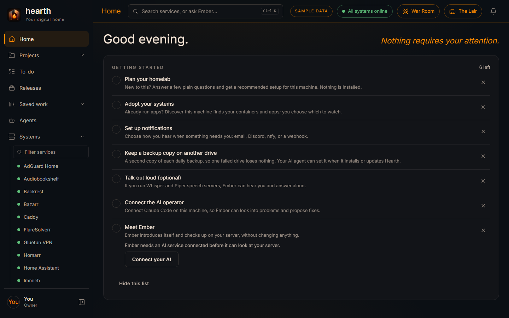

# Hearth

**Your homelab, intelligently managed.**

Hearth brings your services, your infrastructure, and an AI administrator together in one place.
Its AI, Ember, looks after your homelab with you: it investigates problems, explains them in plain
words, and fixes things through plans you approve.

> **Hearth is in active development and is not available to download yet.** This repository is
> its public showcase: progress, roadmap, and development updates. Hearth's source code is not
> published here.

## Follow along

- **Website:** https://jpdexter101-lang.github.io/hearth-showcase/
- **Releases:** choose **Watch → Custom → Releases** at the top of this page to hear when Hearth
  is available.
- **Updates feed:** subscribe to the site's `feed.xml` in any feed reader.

## What's here

| Path | What it is |
| --- | --- |
| `content/` | The site's text: milestones, roadmap, and development updates |
| `assets/` | Styles, the Hearth mark, Ember's picture, and screenshots (sample data) |
| `docs/` | The built website that GitHub Pages serves |
| `build.mjs`, `check.mjs` | Build the site; check it before anything is published |

## Status labels

Every milestone on the site is in one of five stages: **Planned**, **In development**,
**Implemented** (built and passing automated tests), **Verified** (personally confirmed on a real
homelab), and **Released** (in a public download). Hearth doesn't publish an overall percentage.

© 2026 Dragon's Oath. All rights reserved (see [LICENSE](LICENSE)). App names and logos visible in
screenshots belong to their owners and are used only to identify them.
